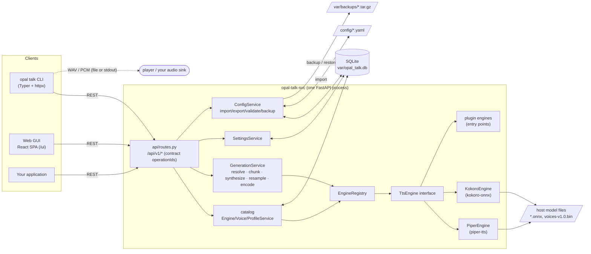
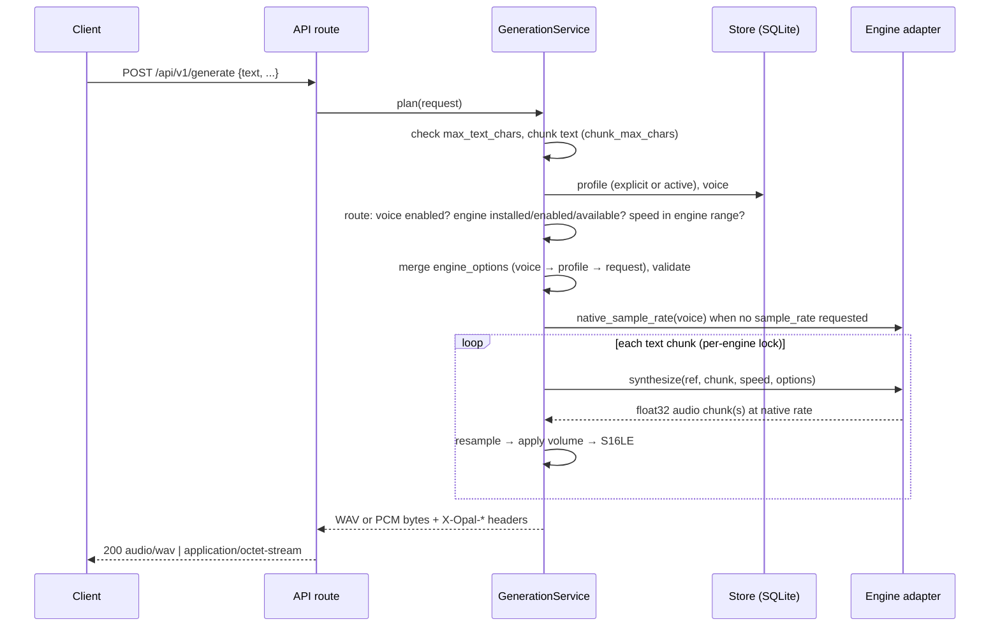

# OPAL Talk User Guide

OPAL Talk (`opal-talk-svc`) is a local, implementation-neutral text-to-speech (TTS) service for Linux and
Raspberry Pi. It puts one stable REST contract in front of TTS engines that are installed on the host,
such as **Piper** and **Kokoro**. You send it plain text, and it returns audio:

```bash
curl -s -X POST http://127.0.0.1:8001/api/v1/generate \
  -H 'Content-Type: application/json' \
  -d '{"text": "Hello from OPAL Talk."}' -o hello.wav
```

```
HTTP/1.1 200 OK
content-type: audio/wav
x-opal-audio-format: wav
x-opal-sample-rate: 16000
x-opal-channels: 1
x-opal-sample-format: s16le
x-opal-engine-id: piper
x-opal-voice-id: en-us-amy-low
x-opal-profile-id: 1
```

It does **not** play audio. It only produces it, either as a finished WAV or raw PCM body, or as a raw
PCM stream that starts while the rest of the text is still being synthesized. Your own code (or a player
such as `aplay`) does the playback.

There are three ways to use it, and all three can do the same things:

| Interface | Use it for | Entry point |
|---|---|---|
| REST API | Integrations, automation, scripts | `http://<host>:8001/api/v1/...`, docs at `/docs` |
| CLI | Terminal use, shell scripts, CI | `opal talk <group> <command>` (or `opal-talk ...`) |
| Web GUI (SPA) | Interactive configuration, listening and testing | `http://<host>:8001/ui/` |

---

## Table of contents

1. [Concepts](#1-concepts)
2. [Installation](#2-installation)
3. [Architecture](#3-architecture)
4. [Configuration reference](#4-configuration-reference)
5. [REST API reference](#5-rest-api-reference)
6. [Audio output and streaming](#6-audio-output-and-streaming)
7. [CLI reference](#7-cli-reference)
8. [Web GUI guide](#8-web-gui-guide)
9. [Recipes and workflows](#9-recipes-and-workflows)
10. [Integrating with your application](#10-integrating-with-your-application)
11. [Testing](#11-testing)
12. [Troubleshooting and FAQ](#12-troubleshooting-and-faq)
13. [Appendix: operation ↔ CLI ↔ GUI map](#13-appendix-operation--cli--gui-map)

---

## 1. Concepts

| Term | Meaning | Example |
|---|---|---|
| **Engine** | A TTS runtime installed on the host. Engines are discovered by the service, not created through the API. Each one can be enabled or disabled and has engine-scope options. | `piper`, `kokoro` |
| **Voice** | A registration that points at a voice/model resource **already installed on the host**. It has a globally unique `voice_id` and is bound to one engine. | `en-us-amy-low` |
| **Engine voice ref** | The opaque, engine-specific reference stored on a voice (`engine_voice_ref`). Only the adapter interprets it. | Piper: `en_US-amy-low` or `/opt/voices/x.onnx`. Kokoro: `af_heart` |
| **Profile** | A reusable set of generation settings: voice, speed, volume, output format, sample rate and engine options. Profiles have a numeric id and a unique name. | `default`, `telephony` |
| **Active profile** | At most one profile is active. It's used whenever a request doesn't name a profile. | `default` (id 1) |
| **Engine options** | Opaque, engine-specific settings (`engine_options` / `options`). Each adapter declares the keys it accepts and their scope. | `{"noise_scale": 0.5}`, `{"lang": "en-gb"}` |
| **Setting** | A service-wide key/value pair, stored as a string. Known keys are validated. | `max_text_chars = 20000` |
| **Generation** | Turning text into audio: completed (`/generate`) or streamed (`/generate/stream`). | |
| **Chunking** | Long text is split internally at sentence boundaries. Chunk boundaries never show in the API or in the audio. | `chunk_max_chars = 400` |
| **Backup** | A `.tar.gz` holding the logical configuration (engines, voices, profiles, settings) as JSON. It never contains model files. | `opal-talk-2026-10-12T162205Z.tar.gz` |

### Portable controls

These controls have the same meaning on every engine:

| Control | Range | Meaning |
|---|---|---|
| `voice_id` | registered voice | Which voice to use. Normally it also selects the engine. |
| `speed` | `0.25`–`4.0` | Speaking rate; `1.0` is the voice's normal pace. An engine can support a narrower range (Kokoro: `0.5`–`2.0`). Out-of-range values are rejected, never clamped. |
| `volume` | `0.0`–`2.0` | Linear gain applied by the service. Samples are clipped to full scale. |
| `output_format` | `wav`, `pcm` | Completed audio as a WAV file or raw PCM. Streaming is always raw PCM. |
| `sample_rate` | `8000`–`192000` | Output rate in Hz. If omitted, the voice's native rate is used. The service resamples when needed. |
| `engine_id` | installed engine | Advanced override. The engine must be able to use the voice. |
| `engine_options` | object | Everything engine-specific |

### Audio formats

| Format | Body | Details |
|---|---|---|
| `wav` | RIFF/WAVE file | Signed 16-bit PCM, **mono**, at the output sample rate |
| `pcm` | Raw samples, no header | Signed 16-bit little-endian (`s16le`), **mono**. The rate is in the `X-Opal-Sample-Rate` header. |
| stream | Raw samples, progressive | Same as `pcm`, delivered as it's generated |

### Engine option scopes

| Scope | Set on | Typical keys |
|---|---|---|
| `engine` | The engine (`PATCH /engines/{id}`). Applies service-wide. | Piper `voices_dir`, `use_cuda`, `cache_size`; Kokoro `model_path`, `voices_path`, `default_lang` |
| `voice` | A voice registration. Voices also accept generation keys as per-voice defaults. | Piper `config_path` (+ generation keys) |
| `generation` | A profile, a generate request, or a voice test | Piper `noise_scale`, `speaker_id`, ...; Kokoro `lang` |

See [4.5 Engine options](#45-engine-options) for every key.

---

## 2. Installation

### 2.1 Prerequisites

- Linux or Raspberry Pi OS (64-bit), Python **3.11 or newer**
- Node **18 or newer**, only if you want to build the web GUI
- At least one engine runtime. Both are Python packages, installed through extras:
  - Piper: [`piper-tts`](https://github.com/OHF-Voice/piper1-gpl) (extra `piper`)
  - Kokoro: [`kokoro-onnx`](https://github.com/thewh1teagle/kokoro-onnx) (extra `kokoro`)
- Voice/model files for those engines, installed on the host (see [2.3](#23-install-engine-resources))
- Optional: `alsa-utils` (`aplay`), `pulseaudio-utils` (`pacat`), `sox` or `ffmpeg` to play and convert
  the output

### 2.2 Install from source

```bash
cd /gh/opal/opal-talk
python3 -m venv .venv
source .venv/bin/activate
pip install -e '.[engines,dev]'      # both engines + dev tools (pytest, ruff, jsonschema)
# pip install -e '.[piper]'          # Piper only
# pip install -e '.[kokoro]'         # Kokoro only
# pip install -e .                   # core only (no engine will be available)
# or: make install
```

This installs three commands:

| Command | Purpose |
|---|---|
| `opal-talk-svc` | Runs the REST service (same as `python -m opal_talk`) |
| `opal-talk` | The CLI. Always unambiguous. |
| `opal` | Shared OPAL CLI root: `opal talk ...` (also mounts `opal listen` when OPAL Listen is importable) |

> OPAL Listen installs an `opal` script too. With both packages in one environment, the last one
> installed owns `opal`. Use `opal-talk` in scripts to avoid surprises.

### 2.3 Install engine resources

OPAL Talk never uploads, downloads or deletes model files. You install them on the host and then
**register** voices that point at them.

**Piper.** Each voice is an `.onnx` model plus an `.onnx.json` config with the same name. Put them in one
directory and set Piper's `voices_dir` (the seeded config uses `~/piper/voices`):

```bash
mkdir -p ~/piper/voices && cd ~/piper/voices
base=https://huggingface.co/rhasspy/piper-voices/resolve/main/en/en_US
wget $base/amy/low/en_US-amy-low.onnx            $base/amy/low/en_US-amy-low.onnx.json
wget $base/lessac/medium/en_US-lessac-medium.onnx $base/lessac/medium/en_US-lessac-medium.onnx.json
```

With `voices_dir` set, voices can be referenced by name (`en_US-amy-low`). Without it, register them by
absolute path.

**Kokoro.** You need the model (`kokoro-v1.0.onnx`, or the smaller `kokoro-v1.0.int8.onnx`) and the
voices file (`voices-v1.0.bin`) from the
[kokoro-onnx releases](https://github.com/thewh1teagle/kokoro-onnx/releases). The seeded config expects
them in `~/kokoro`:

```bash
mkdir -p ~/kokoro && cd ~/kokoro
rel=https://github.com/thewh1teagle/kokoro-onnx/releases/download/model-files-v1.0
wget $rel/kokoro-v1.0.int8.onnx $rel/voices-v1.0.bin
```

Kokoro voices are referenced by name (`af_heart`, `bm_george`, ...). All voices live in the one voices
file.

### 2.4 Service configuration and environment variables

The service reads one YAML file: `--config PATH`, otherwise `$OPAL_TALK_CONFIG`, otherwise
`./config/service.yaml` (if it exists), otherwise built-in defaults. Environment variables override
individual fields:

| Variable | `service.yaml` key | Default | Purpose |
|---|---|---|---|
| `OPAL_TALK_CONFIG` | | `./config/service.yaml` | Service config file |
| `OPAL_TALK_HOST` | `host` | `127.0.0.1` | Bind address. Use `0.0.0.0` to allow other machines. |
| `OPAL_TALK_PORT` | `port` | `8001` | API port |
| `OPAL_TALK_DATA_DIR` | `data_dir` | `./var` | Directory for `opal_talk.db` (SQLite) and `backups/` |
| `OPAL_TALK_CONFIG_DIR` | `config_dir` | `./config` | YAML used by import and on first start |
| `OPAL_TALK_SPA_DIR` | `spa_dir` | none (`./spa/dist` in the shipped YAML) | Built web GUI, served at `/ui` |
| | `log_level` | `info` | Python/uvicorn log level |
| | `cors_origins` | `http://localhost:5173`, `http://127.0.0.1:5173` | Browser origins allowed to call the API |
| | `engines` | none | Initial engine state, applied only when an engine is first seen |
| `OPAL_TALK_API_URL` | | `http://127.0.0.1:8001` | API URL used by the **CLI** |
| `VITE_OPAL_TALK_API_URL` | | same origin (dev: `http://127.0.0.1:8001`) | API URL compiled into the **web GUI** at build time |

Relative paths are resolved against the working directory, and `~` is expanded. Command-line flags
override everything:

```bash
opal-talk-svc --config /etc/opal-talk/service.yaml --host 0.0.0.0 --port 8001
```

### 2.5 First start

```bash
opal-talk-svc                     # or: python -m opal_talk, or: make run
```

On first start the service:

1. Creates the data dir (`./var/`) and the SQLite database `var/opal_talk.db`.
2. Discovers the engines: the built-in Piper and Kokoro adapters, plus plugins registered under the
   `opal_talk.engines` entry point.
3. Stores the initial state of each newly seen engine: the adapter defaults, overlaid with
   `service.yaml` → `engines.<id>`.
4. If the database is new and `config_dir` exists, imports `config/{engines,voices,profiles,settings}.yaml`.
   The seed registers four voices (`en-us-amy-low`, `en-us-lessac-medium`, `kokoro-af-heart`,
   `kokoro-bm-george`), three profiles (`default` (active), `kokoro`, `telephony`) and two settings. If
   the import is invalid it's skipped with a warning in the log, and the service still starts.
5. Mounts the web GUI at `/ui` if `spa_dir` exists.

Useful URLs:

| URL | What |
|---|---|
| `http://127.0.0.1:8001/` | Service info |
| `http://127.0.0.1:8001/healthz` | Liveness probe |
| `http://127.0.0.1:8001/api/v1/health/` | Readiness and engine state |
| `http://127.0.0.1:8001/docs` | Swagger UI (interactive API docs) |
| `http://127.0.0.1:8001/redoc` | ReDoc |
| `http://127.0.0.1:8001/openapi.json` | The authoritative contract (`opal_talk.yaml`), published as is |
| `http://127.0.0.1:8001/ui/` | Web GUI (after `npm run build` in `spa/`) |

### 2.6 Verify the installation

```bash
opal talk ping                      # ok
opal talk health                    # status: ok, both engines available
opal talk voices list               # native_sample_rate is filled in when a voice resolves
opal talk backup validate           # valid
opal talk generate "Hello from OPAL Talk." -o hello.wav && aplay hello.wav
opal talk generate "Streaming works too." --stream -o - | aplay -r 16000 -f S16_LE -c 1 -t raw
```

`health` should say `status: ok`. An engine that shows `available: no` has a missing runtime or missing
files, and the `MESSAGE` column says which.

### 2.7 Access from other machines

By default the service only listens on `127.0.0.1`. To reach it from other machines, bind to all
interfaces and point clients at it:

```bash
OPAL_TALK_HOST=0.0.0.0 opal-talk-svc              # on the Pi
hostname -I                                       # find its address
export OPAL_TALK_API_URL=http://192.168.1.50:8001 # on your laptop
opal talk health
```

If a firewall is active, open the port for your subnet only:

```bash
sudo ufw allow from 192.168.1.0/24 to any port 8001 proto tcp
```

For a browser app on another origin, add that origin to `cors_origins` in `service.yaml`. The `X-Opal-*`
response headers are exposed to browsers through CORS.

> **Security:** the API has no authentication. Keep it on a trusted network, or keep the default
> `127.0.0.1` binding. Anyone who can reach it can change the configuration and use the CPU for
> synthesis.

### 2.8 Run as a systemd service (example)

`/etc/systemd/system/opal-talk.service`:

```ini
[Unit]
Description=OPAL Talk text-to-speech API
After=network-online.target
Wants=network-online.target

[Service]
User=pi
WorkingDirectory=/home/pi/opal-talk
Environment=OPAL_TALK_HOST=0.0.0.0
Environment=OPAL_TALK_DATA_DIR=/home/pi/opal-talk-data
ExecStart=/home/pi/opal-talk/.venv/bin/opal-talk-svc --config /home/pi/opal-talk/config/service.yaml
Restart=on-failure
RestartSec=3

[Install]
WantedBy=multi-user.target
```

```bash
sudo systemctl daemon-reload
sudo systemctl enable --now opal-talk
journalctl -u opal-talk -f
opal talk health
```

Engine options such as `~/piper/voices` are expanded for the service's user, so run the service as the
user who owns the model files, or use absolute paths.

### 2.9 Build the web GUI

```bash
cd spa
npm install
npm run build          # writes spa/dist, served by the service at /ui
# or, from the repo root: make install-spa && make spa-build
```

For GUI development, run the Vite dev server against a running service:

```bash
make spa-dev           # http://127.0.0.1:5173, API at http://127.0.0.1:8001
VITE_OPAL_TALK_API_URL=http://pi5.local:8001 npm run dev   # against a remote service
```

### 2.10 Upgrading

```bash
opal talk backup create              # safety copy of the configuration
git pull
pip install -e '.[engines,dev]'
(cd spa && npm install && npm run build)
sudo systemctl restart opal-talk     # the database schema is created/updated on startup
opal talk health
opal talk backup validate
```

---

## 3. Architecture

### 3.1 Big picture



The code is organized in layers:

| Layer | Package | Responsibility |
|---|---|---|
| API | `opal_talk/api/` | FastAPI app and thin routes. Every route's `operation_id` equals the contract's `operationId`. `/openapi.json` serves the contract itself. |
| Service | `opal_talk/service/` | Catalog (engines, voices, profiles), generation, settings, configuration/backup, error types |
| TTS core | `opal_talk/tts/` | Engine-neutral `TtsEngine` interface, chunking, resampling/gain/WAV encoding, the registry, and the Piper and Kokoro adapters |
| Persistence | `opal_talk/persistence/` | A thin, thread-safe SQLite repository |
| CLI | `opal_talk/cli/` | An HTTP client with an operation map, plus the Typer commands |
| SPA | `spa/` | React + Vite. Talks only to the REST API. |

### 3.2 Components

| Component | What it does |
|---|---|
| `TtsEngine` (`tts/base.py`) | The interface every adapter implements: `availability()`, `describe_voice()`, `synthesize()`, `validate()`, declarative `option_specs` (type, scope, range), and `speed_range`. Nothing in the core knows about a specific engine. |
| `PiperEngine` | Resolves models by path or through `voices_dir`, reads the `.onnx.json` (native rate, language, speakers), keeps an LRU cache of loaded voices (`cache_size`), and maps speed to Piper's length scale. |
| `KokoroEngine` | Loads the Kokoro model and voices file once, checks voice names against the voices file, derives the language from the voice prefix, and produces 24 kHz audio. Speed `0.5`–`2.0`. |
| `EngineRegistry` | Built-in adapters plus plugins from the `opal_talk.engines` entry point group. A plugin that fails to load is logged and skipped. |
| `EngineService` | Persists the enabled flag and options per engine, merge-patches options, and pushes them into the adapter (which drops its caches). |
| `VoiceService` | Registers voices, resolves references when the engine is available (native rate, language, metadata), and protects voices that profiles use. |
| `ProfileService` | CRUD, the single-active-profile rule, and activation checks (voice enabled, engine usable). |
| `GenerationService` | Resolves the request against the profile and settings, routes to an engine, chunks the text, synthesizes, resamples, applies volume, and encodes WAV or PCM. Streams one block per engine audio chunk. |
| `ConfigService` | Export, YAML import, whole-configuration validation, and `.tar.gz` backups (create, list, download, restore, delete). |
| `SettingsService` | Key/value settings, validation of known keys, and effective values with built-in defaults. |

### 3.3 Generation flow



For `/generate/stream`, the same plan is used, but each PCM block is sent as soon as it's ready. The
first block is produced **before** the response headers are sent, so any failure up to that point
becomes a normal JSON error (see [6.3](#63-streaming)).

### 3.4 How a request is resolved

Each portable value comes from the first source that sets it:

| Value | 1. Request | 2. Profile (explicit `profile_id`, else active) | 3. Setting | 4. Built-in |
|---|---|---|---|---|
| Voice | `voice_id` | `voice_id` | | — (`409 no_voice`) |
| Engine | `engine_id` | | | the voice's `engine_id` |
| Speed | `speed` | `speed` | `default_speed` | `1.0` |
| Volume | `volume` | `volume` | `default_volume` | `1.0` |
| Format | `output_format` | `output_format` | `default_output_format` | `wav` |
| Sample rate | `sample_rate` | `sample_rate` | | the voice's native rate |

`engine_options` are merged as shallow layers, later wins: **voice → profile → request**. Profile options
are only used when the request is routed to the same engine as the profile's own voice. Because
engine options are engine-specific, a profile's Piper options are never sent to Kokoro when a request
overrides the voice.

`POST /voices/{id}/test` is different. It uses only the voice and the test request (and the test
request's own defaults): no profile and no `default_*` settings.

### 3.5 Chunking

Text is split at sentence ends (`.`, `!`, `?`, `…`, `;`, `:` followed by whitespace) and at line breaks.
Pieces are then packed into chunks of at most `chunk_max_chars` characters. A sentence that's too long is
split at clause punctuation, then at word boundaries, and as a last resort inside a word. Whitespace is
normalized. Chunks are synthesized in order and concatenated, so the boundaries can't be seen in the
output. For streaming, a smaller `chunk_max_chars` means the first audio arrives sooner.

### 3.6 Validate before apply

Every configuration change is validated before it's stored:

- **Single changes** (create/update a voice, profile, engine or setting) are checked against the
  engine's option specs, cross-references and activation rules. They're rejected with `409` or `422`,
  and nothing is stored.
- **Bulk changes** (`backup/import`, `backup/restore`) validate the whole candidate configuration first:
  duplicates, unknown engines and voices, option types and scopes, the single active profile, settings,
  and whether voice resources resolve. Only a valid candidate is applied, in one SQLite transaction.

Resources on the host are treated differently depending on the operation:

| Operation | Voice reference doesn't resolve |
|---|---|
| `POST /voices/`, `PATCH /voices/{id}` | `422` (if the engine is available; otherwise it's stored unresolved) |
| `POST /voices/{id}/validate`, `GET /backup/validate` | **error** |
| `POST /backup/import`, `POST /backup/restore/{f}` | **warning** (so a configuration can be moved to a host that's still missing models) |

### 3.7 Storage

One SQLite database (default `var/opal_talk.db`). The schema is created on startup:

| Table | Holds |
|---|---|
| `engines` | `engine_id`, `enabled`, `options` (JSON) |
| `voices` | registration fields, `native_sample_rate`, `engine_options` and `metadata` (JSON), timestamps |
| `profiles` | `id`, unique `name`, `is_active`, voice, speed, volume, format, sample rate, `engine_options` (JSON), timestamps |
| `settings` | unique `key`, string `value`, `updated_at` |

There's no request log, synthesis history or audio cache. Generated audio is never stored.

Backups are `.tar.gz` files in `var/backups/`, named `opal-talk-<UTC timestamp>.tar.gz`. Each one contains
a single `opal-talk-config.json` document.

### 3.8 Reliability features

| Feature | Behavior |
|---|---|
| Per-engine serialization | Synthesis calls to the same engine run one at a time (a per-engine lock). Different engines run in parallel. |
| Model caching | Piper keeps up to `cache_size` loaded voices (LRU). Kokoro loads its model once. Changing engine options drops the caches. |
| No silent clamping | Out-of-range speed for an engine is `409 unsupported_speed`, never adjusted. |
| Early stream errors | The first audio block is produced before `200` is committed, so most failures are JSON errors. |
| Explicit stream abort | A failure after the first block aborts the chunked response without a terminating chunk, so clients see an incomplete read instead of truncated "valid" audio. |
| Safe backups | Filenames must match the backup pattern and can't contain path separators or `..`. Backups are written to a temp file and renamed atomically. |
| Atomic bulk changes | Import and restore validate first and replace everything in one transaction. |
| Isolated engine plugins | A broken plugin is logged and skipped, and the service still starts. |
| Health | `ok` / `degraded` / `error` from each enabled engine's availability. |

---

## 4. Configuration reference

The live configuration is stored in SQLite and edited through the API, the CLI or the GUI. For first
start, version control and repeatable deployments, you can also keep it in four YAML files and apply them
with `POST /api/v1/backup/import` (`opal talk backup import`). For moving a configuration between
machines, use backups (see [9.5](#95-back-up-move-and-version-your-configuration)).

### 4.1 `service.yaml`

The process configuration. It's read once at startup and can't be changed through the API.

```yaml
service:
  host: 127.0.0.1
  port: 8001
  log_level: info
  data_dir: ./var            # SQLite state (opal_talk.db) and backups/
  config_dir: ./config       # YAML read by POST /api/v1/backup/import and on first start
  spa_dir: ./spa/dist        # optional: serve the built SPA at /ui
  cors_origins:
    - http://localhost:5173
    - http://127.0.0.1:5173

  # Initial engine state, applied only when an engine is first seen. Later changes are made
  # through PATCH /api/v1/engines/{engine_id} and persisted.
  engines:
    piper:
      enabled: true
      options:
        voices_dir: ~/piper/voices
        use_cuda: false
    kokoro:
      enabled: true
      options:
        model_path: ~/kokoro/kokoro-v1.0.int8.onnx
        voices_path: ~/kokoro/voices-v1.0.bin
        default_lang: en-us
```

The top-level `service:` key is optional; a flat mapping works too. See
[2.4](#24-service-configuration-and-environment-variables) for environment overrides.

### 4.2 Import files (`config/*.yaml`)

| File | Top-level key | Content | Validated as |
|---|---|---|---|
| `engines.yaml` | `engines` | Map of `engine_id` → `{enabled, options}` | `enabled` boolean, `options` a map. Options are checked against the engine's specs. |
| `voices.yaml` | `voices` | List of voices | Same fields and rules as `POST /voices/`; unknown fields are rejected |
| `profiles.yaml` | `profiles` | List of profiles | Same fields and rules as `POST /profiles/`; unknown fields (including `id`) are rejected |
| `settings.yaml` | `settings` | Map of key → scalar | Known keys are range-checked. Booleans become `true`/`false`; lists/maps become JSON strings. |

Every file starts with an optional `version: 1`. Only the files that are present replace their section;
the other sections are kept. Engines in `engines.yaml` that aren't installed are ignored with a warning,
and missing option keys get the adapter's defaults.

```yaml
# config/engines.yaml
version: 1
engines:
  piper:
    enabled: true
    options:
      voices_dir: ~/piper/voices
      use_cuda: false
      cache_size: 4
  kokoro:
    enabled: true
    options:
      model_path: ~/kokoro/kokoro-v1.0.int8.onnx
      voices_path: ~/kokoro/voices-v1.0.bin
      default_lang: en-us
```

```yaml
# config/voices.yaml
version: 1
voices:
  - voice_id: en-us-amy-low
    name: Amy (low)
    engine_id: piper
    engine_voice_ref: en_US-amy-low        # resolved against piper voices_dir
    language: en-US
  - voice_id: kokoro-bm-george
    name: Kokoro George (British)
    engine_id: kokoro
    engine_voice_ref: bm_george
    language: en-GB
  - voice_id: narrator-calm                # optional fields shown
    name: Calm narrator
    description: Piper Lessac with less variation
    engine_id: piper
    engine_voice_ref: /opt/voices/en_US-lessac-medium.onnx
    enabled: true
    engine_options:
      noise_scale: 0.4
      noise_w_scale: 0.5
```

```yaml
# config/profiles.yaml
version: 1
profiles:
  - name: default
    description: General-purpose local speech
    is_active: true                         # at most one
    voice_id: en-us-amy-low
    speed: 1.0
    volume: 1.0
    output_format: wav
    sample_rate: null                       # native rate
    engine_options: {}
  - name: telephony
    description: 8 kHz PCM for telephony pipelines
    voice_id: en-us-amy-low
    output_format: pcm
    sample_rate: 8000
    engine_options:
      noise_scale: 0.5
```

```yaml
# config/settings.yaml
version: 1
settings:
  max_text_chars: 20000
  chunk_max_chars: 400
```

Import **replaces** each section it reads. Voices and profiles that aren't in the files are deleted, and
profiles are numbered `1..N` in file order.

### 4.3 Settings

| Key | Type | Default | Range / values | Effect |
|---|---|---|---|---|
| `max_text_chars` | int | `20000` | 1 to 1000000 | Longer `text` is rejected with `413 payload_too_large` |
| `chunk_max_chars` | int | `400` | 50 to 5000 | Maximum characters per internal synthesis chunk |
| `default_speed` | float | `1.0` | 0.25 to 4.0 | Fallback speed (after request and profile) |
| `default_volume` | float | `1.0` | 0.0 to 2.0 | Fallback volume |
| `default_output_format` | str | `wav` | `wav`, `pcm` | Fallback completed-audio format |

Values are always strings in the API (`"value": "400"`). Known keys are validated on `PUT` (`422` if
invalid). Unknown keys are stored as they are, so you can keep your own metadata there. `GET` only returns
**stored** keys. A known key that isn't stored uses its default internally, but
`GET /settings/{key}` returns `404` for it. Deleting a key restores its default.

### 4.4 Profiles

| Field | Type | Default | Notes |
|---|---|---|---|
| `id` | int | assigned | Read-only. Used in all profile URLs. |
| `name` | str 1–100 | | Unique |
| `description` | str ≤1000 or null | `null` | |
| `is_active` | bool | `false` | Setting it to `true` deactivates every other profile |
| `voice_id` | str | | Must be a registered voice |
| `speed` | float 0.25–4.0 | `1.0` | The engine's own range is checked at generation time |
| `volume` | float 0.0–2.0 | `1.0` | |
| `output_format` | `wav` / `pcm` | `wav` | |
| `sample_rate` | int 8000–192000 or null | `null` | `null` = the voice's native rate |
| `engine_options` | object | `{}` | Generation-scope keys of the voice's engine |
| `created_at`, `updated_at` | str | | Read-only, ISO 8601 UTC |

Rules:

- At most one profile is active. It's possible to have none, for example after
  `PATCH {"is_active": false}`. Then requests need a `voice_id` or `profile_id`.
- A profile can only become active if its voice is enabled and its engine is installed, enabled and
  available.
- The active profile can't be deleted, and its voice can't be disabled.
- A voice can't be deleted while any profile references it.

### 4.5 Engine options

Each adapter declares its keys, the JSON type, the scope and the allowed range. Unknown keys, wrong
scopes, wrong types and out-of-range values are rejected with `422`, and the error lists the allowed keys.

**Piper (`piper`)**

| Key | Scope | Type | Default | Meaning |
|---|---|---|---|---|
| `voices_dir` | engine | string / null | `null` | Directory used to resolve refs given by name (`<dir>/<ref>` or `<dir>/<ref>.onnx`) |
| `use_cuda` | engine | bool | `false` | ONNX inference on CUDA |
| `cache_size` | engine | int 1–32 | `4` | Number of loaded voices kept in memory (LRU) |
| `config_path` | voice | string | `<model>.json` | Explicit `.onnx.json` path |
| `speaker_id` | generation | int 0–100000 | | Speaker index for multi-speaker models |
| `speaker` | generation | string | | Speaker name from the model's `speaker_id_map` (overrides `speaker_id`) |
| `noise_scale` | generation | number 0–2 | model default | Phoneme noise (expressiveness) |
| `noise_w_scale` | generation | number 0–2 | model default | Phoneme-width noise (rhythm variation) |
| `normalize_audio` | generation | bool | `true` | Piper's own output level normalization |

Piper supports speed `0.25`–`4.0`. A voice's native rate comes from `audio.sample_rate` in its config,
typically 16000 (`low`) or 22050 (`medium`/`high`).

**Kokoro (`kokoro`)**

| Key | Scope | Type | Default | Meaning |
|---|---|---|---|---|
| `model_path` | engine | string / null | `null` | `kokoro-v1.0.onnx` or `kokoro-v1.0.int8.onnx` (required) |
| `voices_path` | engine | string / null | `null` | `voices-v1.0.bin` (required) |
| `default_lang` | engine | language | `en-us` | Fallback when the voice prefix is unknown |
| `lang` | generation | language | from the voice prefix | Pronunciation language |

Languages: `en-us`, `en-gb`, `es`, `fr-fr`, `hi`, `it`, `ja`, `pt-br`, `cmn`. The first letter of a voice
name selects the language (`a` en-us, `b` en-gb, `e` es, `f` fr-fr, `h` hi, `i` it, `j` ja, `p` pt-br,
`z` cmn), and the second letter is the gender (`f`/`m`). Kokoro always generates 24 kHz audio and
supports speed `0.5`–`2.0`.

### 4.6 Validation rules

`GET /api/v1/backup/validate`, import and restore check the whole configuration:

| Area | Errors | Warnings |
|---|---|---|
| Engines | invalid engine options | `engine_not_installed` (in imported files) |
| Voices | `duplicate_voice`, `engine_not_found`, invalid voice `engine_options`, unresolvable reference (validate only) | unresolvable reference (import/restore), `voice_not_checked` (engine unavailable) |
| Profiles | `duplicate_profile`, `voice_not_found`, `multiple_active_profiles`, invalid generation `engine_options` | `no_active_profile`, `voice_disabled` (active profile) |
| Settings | `invalid_setting` (known key out of range) | |
| Files (import) | `yaml_invalid`, `schema_invalid` | |

Every message has a `code`, a `message`, an optional `field` (for example
`profiles.telephony.engine_options.noise_scale`) and `details`.

---

## 5. REST API reference

### 5.1 Conventions

- **Contract-first:** the authoritative contract is `opal_talk.yaml` (OpenAPI 3.1, API `v1`, contract
  version 1.0.0). Every route uses the contract's `operationId`, and `/openapi.json` publishes the
  contract file itself rather than a generated schema.
- **Base URL:** `http://<host>:8001`. All resources are under `/api/v1`.
- **Trailing slashes:** collection endpoints end with `/` (for example `/api/v1/voices/`). Calling them
  without the slash triggers a redirect.
- **IDs:** engines and voices are addressed by their string ids, profiles by integer id (`≥ 1`), settings
  by key, and backups by filename. Path ids are not pattern-checked: an unknown or malformed id is simply
  `404`.
- **Content type:** JSON (`Content-Type: application/json`) for requests and for non-audio responses.
  Audio responses are `audio/wav` or `application/octet-stream`. Backup downloads are
  `application/octet-stream` with a `Content-Disposition` filename.
- **Strict bodies:** unknown fields are rejected with `422` (`extra_forbidden`). `PATCH` bodies need at
  least one field. Only nullable fields (`description`, `language`, `sample_rate`) may be set to `null`;
  for every other field, `null` is a `422`.
- **Timestamps:** ISO 8601, UTC, with a `Z` suffix, for example `2026-10-12T16:19:33.361017Z`.
- **Authentication:** none (see [Security](#27-access-from-other-machines)).
- **Concurrency:** last write wins. There are no ETags or `If-Match` preconditions in this version.

> The repository also contains `opal_talk.1.2.0.yaml`, which adopts the OPAL Suite Standard v1.2
> (correlation headers, ETag/`If-Match`, `health/live` and `health/ready`, an atomic
> `PATCH /settings/`, and `POST /backup/validate`). That revision is **not implemented yet**. This guide
> documents the running service.

The examples below use:

```bash
API=http://127.0.0.1:8001
```

### 5.2 Errors

Service errors use one envelope:

```json
{"code": "voice_in_use", "message": "voice 'en-us-amy-low' is referenced by 2 profile(s)", "details": {"profile_ids": [1, 3]}}
```

Request validation errors use FastAPI's `HTTPValidationError` shape, with `loc` pointing at the field:

```json
{"detail": [{"type": "unsupported_option", "loc": ["body", "engine_options", "lang"],
             "msg": "unsupported option 'lang' (allowed: ['noise_scale', 'noise_w_scale', 'normalize_audio', 'speaker', 'speaker_id'])",
             "input": "en-us"}]}
```

| Status | When | Codes |
|---|---|---|
| `404` | Resource not found | `engine_not_found`, `voice_not_found`, `profile_not_found`, `backup_not_found`, `not_found` |
| `409` | Conflict with the current state | `voice_exists`, `voice_in_use`, `voice_disabled`, `profile_name_exists`, `profile_active`, `profile_options_incompatible`, `engine_disabled`, `engine_unavailable`, `engine_not_found`, `profile_not_found`/`voice_not_found`/`no_voice`/`voice_engine_mismatch`/`unsupported_speed` (generation), `invalid_backup`, `backup_invalid`, `config_not_found` |
| `413` | Text longer than `max_text_chars` | `payload_too_large` (`details`: `max_text_chars`, `text_length`) |
| `422` | Request validation, unsupported/invalid engine options, unresolvable voice reference, invalid known setting | `detail[]` |
| `500` | Synthesis or I/O failure | `generation_failed`, `backup_failed`, `import_failed`, `restore_failed`, `internal_error` |
| `503` | The engine runtime or its resources are missing | `engine_unavailable` |

> In generation requests, a missing profile, voice or engine is a `409` (it's a state of the
> configuration), not a `404`. See [CONTRACT_NOTES.md](CONTRACT_NOTES.md) for this and other
> interpretations of the contract.

---

### 5.3 Service

#### `GET /` — service info

```bash
curl -s $API/
```
```json
{"name": "opal-talk-svc", "version": "1.0.0", "api_version": "v1",
 "description": "Implementation-neutral OPAL text-to-speech service"}
```

#### `GET /healthz` — liveness probe

A cheap check that the process is up. For engine state, use `/api/v1/health/`.

```bash
curl -s $API/healthz
```
```json
{"status": "ok"}
```

---

### 5.4 Engines — `/api/v1/engines`

Engine object:

| Field | Type | Notes |
|---|---|---|
| `engine_id` | str | Fixed by the adapter (`piper`, `kokoro`) |
| `name`, `description` | str | From the adapter |
| `enabled` | bool | Administrative switch: generation is refused while `false` |
| `available` | bool | Computed: the runtime is importable and the required resources exist |
| `options` | object | Engine-scope options |
| `metadata` | object | Adapter, runtime, version, and for Kokoro `native_sample_rate` and `speed_range` |

#### `GET /api/v1/engines/` — list engines

```bash
curl -s $API/api/v1/engines/ | jq -r '.[] | "\(.engine_id)\t\(.enabled)\t\(.available)"'
```

#### `GET /api/v1/engines/{engine_id}` — get one engine

```bash
curl -s $API/api/v1/engines/piper
```
```json
{
  "engine_id": "piper", "name": "Piper",
  "description": "Local neural text-to-speech engine (piper-tts, ONNX voices)",
  "enabled": true, "available": true,
  "options": {"use_cuda": false, "voices_dir": "~/piper/voices", "cache_size": 4},
  "metadata": {"adapter": "opal_talk.tts.piper_adapter", "runtime": "piper-tts", "version": "1.8.0"}
}
```

#### `PATCH /api/v1/engines/{engine_id}` — enable/disable or change options

The body is `{"enabled"?: bool, "options"?: {...}}`, with at least one field. `options` is a top-level
JSON **merge-patch**: supplied keys replace, `null` removes a key, and other keys are kept. The merged
result is validated (`422` if invalid), stored, and applied to the adapter immediately.

```bash
curl -s -X PATCH $API/api/v1/engines/piper -H 'Content-Type: application/json' \
  -d '{"options": {"cache_size": 8}}'

curl -s -X PATCH $API/api/v1/engines/kokoro -H 'Content-Type: application/json' -d '{"enabled": false}'
```

#### `POST /api/v1/engines/{engine_id}/validate` — validate runtime and configuration

```bash
curl -s -X POST $API/api/v1/engines/kokoro/validate
```
```json
{"valid": false, "errors": [{"code": "engine_unavailable", "message": "Kokoro model file '/nope.onnx' not found", "field": null, "details": {}}],
 "warnings": [], "details": {"adapter": "opal_talk.tts.kokoro_adapter", "runtime": "kokoro-onnx", "native_sample_rate": 24000, "speed_range": [0.5, 2.0], "version": "0.6.1"}}
```

`validate` checks the engine options and availability. For Kokoro it also loads the model and counts
the voices (`details.voice_count`). A disabled engine gets the warning `engine_disabled`. The response is
always `200`; check `valid`.

---

### 5.5 Voices — `/api/v1/voices`

Voice object:

| Field | Type | Notes |
|---|---|---|
| `voice_id` | str 1–200, `^[A-Za-z0-9][A-Za-z0-9._-]*$` | Unique. Immutable. |
| `name` | str 1–200 | |
| `description` | str ≤1000 or null | |
| `engine_id` | str | Installed engine |
| `engine_voice_ref` | str 1–2048 | Opaque engine reference |
| `language` | str ≤64 or null | Detected from the model if omitted on create |
| `enabled` | bool | default `true` |
| `native_sample_rate` | int or null | Read-only, resolved from the model |
| `engine_options` | object | Voice-scope + generation-scope keys |
| `metadata` | object | Read-only, from the adapter (model/config paths, quality, speakers, ...) |
| `created_at`, `updated_at` | str | Read-only |

#### `GET /api/v1/voices/` — list voices

| Query | Meaning |
|---|---|
| `engine_id` | Only voices of this engine |
| `enabled` | `true` or `false` |

```bash
curl -s "$API/api/v1/voices/?engine_id=kokoro&enabled=true" | jq -r '.[].voice_id'
```

#### `POST /api/v1/voices/` — register a voice → `201`

```bash
curl -s -X POST $API/api/v1/voices/ -H 'Content-Type: application/json' -d '{
  "voice_id": "amy-medium", "name": "Amy (medium)",
  "engine_id": "piper", "engine_voice_ref": "en_US-amy-medium"
}'
```
```json
{
  "voice_id": "amy-medium", "name": "Amy (medium)", "description": null,
  "engine_id": "piper", "engine_voice_ref": "en_US-amy-medium", "language": "en-US", "enabled": true,
  "native_sample_rate": 22050, "engine_options": {},
  "metadata": {"model_path": "/home/pi/piper/voices/en_US-amy-medium.onnx",
               "config_path": "/home/pi/piper/voices/en_US-amy-medium.onnx.json",
               "quality": "medium", "dataset": "amy", "num_speakers": 1, "speakers": [], "piper_version": "1.0.0"},
  "created_at": "2026-10-12T16:19:53.748552Z", "updated_at": "2026-10-12T16:19:53.748552Z"
}
```

| Error | When |
|---|---|
| `404 engine_not_found` | Unknown `engine_id` |
| `409 voice_exists` | The `voice_id` is taken |
| `422` | Schema error, invalid `engine_options`, or a reference that doesn't resolve (while the engine is available) |

#### `GET /api/v1/voices/{voice_id}` — get one voice

```bash
curl -s $API/api/v1/voices/en-us-amy-low
```

#### `PATCH /api/v1/voices/{voice_id}` — update a voice

Any subset of `name`, `description`, `engine_id`, `engine_voice_ref`, `language`, `enabled` and
`engine_options`. `engine_options` is **replaced** as a whole. Changing the engine, the reference or the
options re-resolves the voice (native rate, metadata).

```bash
curl -s -X PATCH $API/api/v1/voices/amy-medium -H 'Content-Type: application/json' \
  -d '{"description": "Warmer Amy", "engine_options": {"noise_scale": 0.4}}'
```

| Error | When |
|---|---|
| `404 engine_not_found` | The new `engine_id` isn't installed |
| `409 voice_in_use` | `enabled: false` on the voice of the active profile |
| `409 profile_options_incompatible` | A new `engine_id` would invalidate a referencing profile's `engine_options` |

#### `DELETE /api/v1/voices/{voice_id}` — unregister → `204`

Host files are never touched. Returns `409 voice_in_use` (with `details.profile_ids`) while any profile
references the voice.

```bash
curl -s -X DELETE $API/api/v1/voices/amy-medium -o /dev/null -w '%{http_code}\n'   # 204
```

#### `POST /api/v1/voices/{voice_id}/validate` — validate a registration

```bash
curl -s -X POST $API/api/v1/voices/kokoro-bm-george/validate
```
```json
{"valid": true, "errors": [], "warnings": [], "details": {"native_sample_rate": 24000, "language": "en-gb"}}
```

Error codes: `engine_not_found`, `engine_unavailable`, `model_not_found`, `model_config_not_found`,
`model_config_invalid`, `voice_not_found` (Kokoro), `unsupported_option`, `invalid_option`. Warnings:
`voice_disabled`, `engine_disabled`.

#### `POST /api/v1/voices/{voice_id}/test` — generate a test utterance

The body is optional:

| Field | Default |
|---|---|
| `text` | `"This is a test of the selected OPAL Talk voice."` |
| `speed` | `1.0` |
| `volume` | `1.0` |
| `output_format` | `wav` |
| `sample_rate` | the voice's native rate |
| `engine_options` | `{}` (generation scope, layered over the voice's options) |

No profile and no `default_*` settings are applied. The response is the same as for `/generate`.

```bash
curl -s -X POST $API/api/v1/voices/kokoro-af-heart/test -o test.wav
curl -s -X POST $API/api/v1/voices/en-us-amy-low/test -H 'Content-Type: application/json' \
  -d '{"text": "Testing one two", "output_format": "pcm"}' -o test.pcm
```

---

### 5.6 Profiles — `/api/v1/profiles`

See [4.4 Profiles](#44-profiles) for the fields and rules.

#### `GET /api/v1/profiles/` — list profiles

```bash
curl -s $API/api/v1/profiles/ | jq -r '.[] | "\(.id)\t\(.name)\t\(.is_active)\t\(.voice_id)"'
```

#### `POST /api/v1/profiles/` — create a profile → `201`

```bash
curl -s -X POST $API/api/v1/profiles/ -H 'Content-Type: application/json' -d '{
  "name": "narrator", "description": "Audiobook narration",
  "voice_id": "kokoro-bm-george", "speed": 0.9, "engine_options": {"lang": "en-gb"}
}'
```
```json
{"id": 4, "name": "narrator", "description": "Audiobook narration", "is_active": false,
 "voice_id": "kokoro-bm-george", "speed": 0.9, "volume": 1.0, "output_format": "wav", "sample_rate": null,
 "engine_options": {"lang": "en-gb"}, "created_at": "...", "updated_at": "..."}
```

| Error | When |
|---|---|
| `404 voice_not_found` | Unknown `voice_id` |
| `409 profile_name_exists` | The name is taken |
| `409 voice_disabled` / `engine_*` | `is_active: true` but the voice or engine can't be used |
| `422` | Schema error, or `engine_options` the voice's engine doesn't accept |

#### `GET /api/v1/profiles/{profile_id}` — get one profile

```bash
curl -s $API/api/v1/profiles/3
```

#### `PATCH /api/v1/profiles/{profile_id}` — partial update

Any subset of the writable fields. `engine_options` is **replaced**. `"sample_rate": null` returns to the
native rate. `"is_active": true` activates (and deactivates the others); `"is_active": false` leaves no
active profile.

```bash
curl -s -X PATCH $API/api/v1/profiles/4 -H 'Content-Type: application/json' \
  -d '{"volume": 1.2, "sample_rate": 16000}'
```

#### `DELETE /api/v1/profiles/{profile_id}` — delete → `204`

Returns `409 profile_active` for the active profile.

```bash
curl -s -X DELETE $API/api/v1/profiles/4 -o /dev/null -w '%{http_code}\n'
```

#### `POST /api/v1/profiles/{profile_id}/activate` — activate a profile

```bash
curl -s -X POST $API/api/v1/profiles/2/activate | jq '{id, name, is_active}'
```
```json
{"id": 2, "name": "kokoro", "is_active": true}
```

Returns `409 voice_disabled`, `engine_not_found`, `engine_disabled` or `engine_unavailable` if the
profile's voice can't be used right now.

---

### 5.7 Generation — `/api/v1/generate`

Request fields (all optional except `text`):

| Field | Type | Notes |
|---|---|---|
| `text` | str, ≥1 char | Plain text. Must contain something speakable. Limited by `max_text_chars`. |
| `profile_id` | int ≥1 | Default: the active profile |
| `voice_id` | str | Overrides the profile's voice |
| `engine_id` | str | Advanced routing override; the engine must be able to use the voice |
| `speed` | float 0.25–4.0 | |
| `volume` | float 0.0–2.0 | |
| `output_format` | `wav` / `pcm` | `/generate` only |
| `sample_rate` | int 8000–192000 | |
| `engine_options` | object | Generation-scope keys, layered over voice and profile options |

See [3.4](#34-how-a-request-is-resolved) for how missing fields are resolved.

#### `POST /api/v1/generate` — completed audio

```bash
curl -s -D headers.txt -X POST $API/api/v1/generate -H 'Content-Type: application/json' \
  -d '{"text": "Hello from OPAL Talk.", "voice_id": "kokoro-af-heart", "speed": 1.1}' -o hello.wav
grep -i '^x-opal' headers.txt
```
```
x-opal-audio-format: wav
x-opal-sample-rate: 24000
x-opal-channels: 1
x-opal-sample-format: s16le
x-opal-engine-id: kokoro
x-opal-voice-id: kokoro-af-heart
x-opal-profile-id: 1
```

Response: `200` with `audio/wav` (`output_format: wav`) or `application/octet-stream` (`pcm`). See
[6.1](#61-response-headers) for the headers.

More examples:

```bash
# Raw PCM at a fixed rate, from a specific profile
curl -s -X POST $API/api/v1/generate -H 'Content-Type: application/json' \
  -d '{"text": "Please hold.", "profile_id": 3}' -o hold.raw

# Engine-specific options
curl -s -X POST $API/api/v1/generate -H 'Content-Type: application/json' \
  -d '{"text": "Bonjour", "voice_id": "kokoro-af-heart", "engine_options": {"lang": "fr-fr"}}' -o fr.wav

# A rejected request
curl -s -X POST $API/api/v1/generate -H 'Content-Type: application/json' \
  -d '{"text": "Hi", "profile_id": 2, "speed": 3}'
# 409: {"code": "unsupported_speed", "message": "speed 3.0 is outside the range 0.5..2.0 supported by engine 'kokoro'",
#       "details": {"engine_id": "kokoro", "speed": 3.0, "supported": [0.5, 2.0]}}
```

Generation errors:

| Status | Code | Cause |
|---|---|---|
| `409` | `profile_not_found` | `profile_id` doesn't exist |
| `409` | `voice_not_found` | The voice isn't registered |
| `409` | `no_voice` | No `voice_id`, no `profile_id`, no active profile |
| `409` | `voice_disabled` | The resolved voice is disabled |
| `409` | `engine_not_found` / `engine_disabled` | Engine not installed / disabled |
| `409` | `voice_engine_mismatch` | `engine_id` can't use the voice |
| `409` | `unsupported_speed` | Outside the engine's speed range |
| `413` | `payload_too_large` | Text longer than `max_text_chars` |
| `422` | | Empty/blank text, schema errors, unknown fields, invalid `engine_options` |
| `503` | `engine_unavailable` | Runtime or resources missing |
| `500` | `generation_failed` | The engine failed |

#### `POST /api/v1/generate/stream` — progressive raw PCM

Same request as `/generate` **without** `output_format` (sending it is a `422`). The response is `200`
`application/octet-stream`, sent with chunked transfer encoding: raw S16LE mono PCM delivered as it's
synthesized. See [6.3 Streaming](#63-streaming) for consuming it and for the failure semantics.

```bash
curl -sN -X POST $API/api/v1/generate/stream -H 'Content-Type: application/json' \
  -d '{"text": "First sentence. Second sentence.", "sample_rate": 22050}' \
  | aplay -r 22050 -f S16_LE -c 1 -t raw
```

---

### 5.8 Settings — `/api/v1/settings`

See [4.3 Settings](#43-settings) for the known keys.

#### `GET /api/v1/settings/` — all stored settings as a key → string map

```bash
curl -s $API/api/v1/settings/
```
```json
{"chunk_max_chars": "400", "max_text_chars": "20000"}
```

#### `GET /api/v1/settings/{key}` — one stored setting

```bash
curl -s $API/api/v1/settings/chunk_max_chars
```
```json
{"id": 2, "key": "chunk_max_chars", "value": "400", "updated_at": "2026-10-12T16:19:33.361017Z"}
```

Returns `404 not_found` if the key isn't stored, even for a known key that has a default.

#### `PUT /api/v1/settings/{key}` — create or replace

The body is `{"value": "<string>"}`. Known keys are validated:

```bash
curl -s -X PUT $API/api/v1/settings/default_speed -H 'Content-Type: application/json' -d '{"value": "1.1"}'

curl -s -X PUT $API/api/v1/settings/chunk_max_chars -H 'Content-Type: application/json' -d '{"value": "10"}'
# 422: {"detail": [{"loc": ["body", "value"], "msg": "setting 'chunk_max_chars' must be between 50 and 5000", ...}]}
```

#### `DELETE /api/v1/settings/{key}` — delete → `204`

The default applies again. Returns `404` if the key isn't stored.

```bash
curl -s -X DELETE $API/api/v1/settings/default_speed -o /dev/null -w '%{http_code}\n'
```

---

### 5.9 Health — `/api/v1/health`

#### `GET /api/v1/health/` — readiness and engine state

```bash
curl -s $API/api/v1/health/
```
```json
{
  "status": "degraded",
  "version": "1.0.0",
  "active_profile_id": 1,
  "engines": [
    {"engine_id": "kokoro", "enabled": true, "available": false, "message": "Kokoro model file '/nope.onnx' not found"},
    {"engine_id": "piper", "enabled": true, "available": true, "message": null}
  ],
  "details": {"voices": 4, "enabled_voices": 4, "profiles": 3}
}
```

| `status` | Meaning |
|---|---|
| `ok` | Every enabled engine is available |
| `degraded` | Some enabled engine is unavailable, but at least one is available |
| `error` | No enabled engine is available |

The response is always `200`. Use `status` for readiness decisions, and `/healthz` for liveness.

---

### 5.10 Backup and configuration — `/api/v1/backup`

#### `GET /api/v1/backup/list` — list backups (newest first)

```bash
curl -s $API/api/v1/backup/list
```
```json
[{"filename": "opal-talk-2026-10-12T162205Z.tar.gz", "created_at": "2026-10-12T16:22:05.719126Z", "size_bytes": 1208}]
```

Only files in `<data_dir>/backups/` that match `opal-talk-YYYY-MM-DDTHHMMSSZ[-N].tar.gz` are listed.

#### `POST /api/v1/backup/create` — create a backup

```bash
curl -s -X POST $API/api/v1/backup/create
```
```json
{"filename": "opal-talk-2026-10-12T162205Z.tar.gz", "message": "Backup created successfully."}
```

The archive contains one member, `opal-talk-config.json`, with the same content as
`GET /backup/export`. It's written to a temporary file and renamed atomically. An I/O failure is
`500 backup_failed`.

#### `GET /api/v1/backup/download/{filename}` — download a backup file

```bash
curl -s -OJ $API/api/v1/backup/download/opal-talk-2026-10-12T162205Z.tar.gz
```

#### `POST /api/v1/backup/restore/{filename}` — restore a backup

1. Reads the archive and checks its JSON against the export schema (`409 invalid_backup` if unreadable).
2. Validates the whole configuration. Unresolvable voice resources are warnings; errors give
   `409 backup_invalid` with `details.errors`, and nothing is changed.
3. Replaces voices, profiles (ids kept) and settings, and applies engine `enabled`/`options`, in one
   transaction. **Replaced means deleted and re-created:** voices, profiles and settings that exist now
   but are absent from the backup are removed.

```bash
curl -s -X POST $API/api/v1/backup/restore/opal-talk-2026-10-12T162205Z.tar.gz
```
```json
{"success": true, "message": "Backup restored successfully: replaced voices (4); replaced profiles (4); replaced settings (2); applied engine options (2).",
 "details": {"filename": "opal-talk-2026-10-12T162205Z.tar.gz", "warnings": [],
             "engines": 2, "voices": 4, "profiles": 4, "settings": 2}}
```

> No safety backup is taken automatically. Call `/backup/create` first if you might want to undo.

#### `DELETE /api/v1/backup/{filename}` — delete a backup file → `204`

```bash
curl -s -X DELETE $API/api/v1/backup/opal-talk-2026-10-01T080000Z.tar.gz -o /dev/null -w '%{http_code}\n'
```

Filenames containing `/`, `\`, `..` or NUL are rejected (`422` or `404`). Names that don't match the
backup pattern are `404 backup_not_found`.

#### `GET /api/v1/backup/export` — export the configuration

```bash
curl -s $API/api/v1/backup/export | jq 'keys'
```
```json
["engines", "exported_at", "profiles", "settings", "version", "voices"]
```

`engines`, `voices` and `profiles` use the same objects as the corresponding `GET` endpoints, and
`settings` is the stored key → value map. Model files are never included.

#### `POST /api/v1/backup/import` — import the YAML config directory

There's no request body. The service reads `engines.yaml`, `voices.yaml`, `profiles.yaml` and
`settings.yaml` from its `config_dir` (see [4.2](#42-import-files-configyaml)). Sections for files that
are present are validated together and then replaced in one transaction. **Replaced means deleted and
re-created:** a voice, profile or setting that exists now but is absent from the file is removed (a
resource that disappears can make later requests fail with `404`/`409 not_found`); engine entries are
merged instead — they only set `enabled`/`options` for installed engines. The response `message` lists
what was replaced.

```bash
curl -s -X POST $API/api/v1/backup/import
```
```json
{"success": true,
 "validation": {"valid": true, "errors": [], "warnings": [],
                "details": {"engines": 2, "voices": 4, "profiles": 3, "settings": 2,
                            "files": ["engines.yaml", "voices.yaml", "profiles.yaml", "settings.yaml"]}},
 "message": "Configuration imported successfully: replaced voices (4); replaced profiles (3); replaced settings (2); applied engine options (2)."}
```

| Outcome | Response |
|---|---|
| Valid | `200`, `success: true` |
| Invalid YAML or configuration | `200`, `success: false`, `validation.errors[]`, `"Configuration is invalid; nothing was applied."` |
| No config files | `409 config_not_found` |
| Apply failed | `500 import_failed` (rolled back) |

#### `GET /api/v1/backup/validate` — validate the current configuration

```bash
curl -s $API/api/v1/backup/validate
```
```json
{"valid": true, "errors": [], "warnings": [], "details": {"engines": 2, "voices": 4, "profiles": 3, "settings": 2}}
```

Unlike import and restore, a voice reference that doesn't resolve on this host is an **error** here.

---

## 6. Audio output and streaming

### 6.1 Response headers

Every audio response (`/generate`, `/generate/stream`, `/voices/{id}/test`) describes itself in headers.
They're exposed to browsers through CORS.

| Header | Example | Meaning |
|---|---|---|
| `X-Opal-Audio-Format` | `wav` / `pcm` | Body format (always `pcm` for streams) |
| `X-Opal-Sample-Rate` | `22050` | Output sample rate in Hz |
| `X-Opal-Channels` | `1` | Always mono |
| `X-Opal-Sample-Format` | `s16le` | Always signed 16-bit little-endian |
| `X-Opal-Engine-Id` | `piper` | Engine that synthesized the audio |
| `X-Opal-Voice-Id` | `en-us-amy-low` | Voice that was used |
| `X-Opal-Profile-Id` | `1` | Profile that was applied (absent for voice tests, or when no profile was used) |

### 6.2 Completed audio

`wav` bodies are complete RIFF/WAVE files that any player accepts. `pcm` bodies are the same samples
without a header. To play or convert raw PCM, you need the rate from `X-Opal-Sample-Rate`:

```bash
aplay -r 16000 -f S16_LE -c 1 -t raw hello.pcm
sox -t raw -r 16000 -e signed -b 16 -c 1 hello.pcm hello.wav
ffmpeg -f s16le -ar 16000 -ac 1 -i hello.pcm hello.mp3
```

Volume is a linear gain applied after synthesis (`0.5` ≈ −6 dB, `2.0` ≈ +6 dB), and samples are clipped
to full scale. When `sample_rate` differs from the engine's native rate, the service resamples with a
polyphase filter.

### 6.3 Streaming

`POST /api/v1/generate/stream` returns raw PCM **progressively**. The service synthesizes the text chunk by
chunk and sends each block as soon as it's encoded, so playback can start after the first sentence.

| Aspect | Behavior |
|---|---|
| Body | Raw S16LE mono PCM, no container, no in-band metadata |
| Rate | `X-Opal-Sample-Rate`, fixed for the whole stream |
| Granularity | One or more blocks per internal text chunk. Tune with `chunk_max_chars`. |
| Errors before audio | Normal JSON errors (`409`, `413`, `422`, `503`, ...). The first block is produced before `200` is committed. |
| Errors after audio started | The service aborts the chunked response without the terminating chunk. Clients see an incomplete read, never an in-band error. Treat the audio received so far as incomplete. |
| Format | Always PCM. `output_format` isn't accepted. |

**curl**

```bash
curl -sN -X POST http://127.0.0.1:8001/api/v1/generate/stream \
  -H 'Content-Type: application/json' \
  -d '{"text": "Streaming starts right away.", "voice_id": "kokoro-af-heart"}' \
  | aplay -r 24000 -f S16_LE -c 1 -t raw
```

If the service aborts the stream, curl reports a transfer error (typically exit code `18`, "transfer closed
with outstanding read data remaining") instead of exiting `0`.

**CLI**

```bash
opal talk generate "Streaming starts right away." --stream --sample-rate 24000 -o - \
  | aplay -r 24000 -f S16_LE -c 1 -t raw
```

The CLI reports an aborted stream as `Error: stream terminated prematurely; generation failed (...)` and
exits with `1`.

**Browser (JavaScript)**

```js
const resp = await fetch("http://127.0.0.1:8001/api/v1/generate/stream", {
  method: "POST",
  headers: { "Content-Type": "application/json" },
  body: JSON.stringify({ text: "Hello from the browser." }),
});
if (!resp.ok) throw new Error(JSON.stringify(await resp.json()));
const rate = Number(resp.headers.get("X-Opal-Sample-Rate"));
const reader = resp.body.getReader();
const ctx = new AudioContext({ sampleRate: rate });
let t = ctx.currentTime;
let carry = new Uint8Array(0);
for (;;) {
  const { value, done } = await reader.read();   // throws if the service aborts the stream
  if (done) break;
  const bytes = new Uint8Array(carry.length + value.length);
  bytes.set(carry); bytes.set(value, carry.length);
  const even = bytes.length - (bytes.length % 2);
  carry = bytes.slice(even);
  const pcm = new Int16Array(bytes.buffer.slice(0, even));
  const buf = ctx.createBuffer(1, pcm.length, rate);
  buf.getChannelData(0).set(Float32Array.from(pcm, (s) => s / 32768));
  const src = ctx.createBufferSource();
  src.buffer = buf; src.connect(ctx.destination);
  t = Math.max(t, ctx.currentTime); src.start(t); t += buf.duration;
}
```

See [10.2](#102-python-stream-to-the-sound-card) for a Python player.

---

## 7. CLI reference

This is a summary. The full reference with every option and many more examples is
[CLI.md](CLI.md).

### 7.1 Global usage

```
opal talk [--api-url URL] [--json] [--timeout SECONDS] <group> <command> [args] [options]
opal-talk [--api-url URL] [--json] [--timeout SECONDS] <group> <command> [args] [options]
```

| Option | Default | Meaning |
|---|---|---|
| `--api-url` | `$OPAL_TALK_API_URL` or `http://127.0.0.1:8001` | Service to talk to |
| `--json` | off | Print raw API JSON instead of tables. Must come **before** the group. |
| `--timeout` | `120` | HTTP timeout in seconds |

Rules:

- Every command is one REST call. The CLI never touches the database or the engines.
- Engines and voices are referenced by their string id, and profiles by **numeric id**.
- `-O key=value` (repeatable; values parsed as JSON when possible) and `--options-json '{...}'` pass
  `engine_options`.
- `generate` and `voices test` write audio to `-o FILE` or `-o -` (stdout), and print a summary on stderr.
- No command asks for confirmation.
- `--help` works at every level: `opal talk --help`, `opal talk voices --help`,
  `opal talk voices add --help`.

Exit codes:

| Code | When |
|---|---|
| `0` | Success |
| `1` | API error (4xx/5xx), `validate` result invalid, `backup import` unsuccessful, stream aborted |
| `2` | Invalid CLI usage (bad option, missing argument, out-of-range value, nothing to update), or the service is unreachable |

```bash
opal talk --json voices list | jq -r '.[].voice_id'
opal talk --api-url http://pi5.local:8001 health
OPAL_TALK_API_URL=http://pi5.local:8001 opal talk generate "Hello" -o hello.wav
```

### 7.2 `engines`

| Command | REST | Description |
|---|---|---|
| `engines list` | `GET /api/v1/engines/` | Table: engine_id, name, enabled, available |
| `engines get ENGINE` | `GET /api/v1/engines/{id}` | JSON with options and metadata |
| `engines update ENGINE [--enable/--disable] [-O k=v]... [--options-json J]` | `PATCH /api/v1/engines/{id}` | Options are merged; `k=null` removes a key |
| `engines validate ENGINE` | `POST /api/v1/engines/{id}/validate` | `valid`/`INVALID`; exit `1` if invalid |

```bash
opal talk engines update piper -O voices_dir='"~/piper/voices"' -O cache_size=8
opal talk engines update kokoro --disable
opal talk engines validate kokoro
```

### 7.3 `voices`

| Command | REST | Description |
|---|---|---|
| `voices list [--engine E] [--enabled/--disabled]` | `GET /api/v1/voices/` | Table |
| `voices get VOICE` | `GET /api/v1/voices/{id}` | JSON |
| `voices add VOICE --name N --engine E --ref R [--description D] [--language L] [--enabled/--disabled] [-O k=v]...` | `POST /api/v1/voices/` | Register a host-installed voice |
| `voices update VOICE [--name] [--engine] [--ref] [--description\|--clear-description] [--language\|--clear-language] [--enabled/--disabled] [-O k=v]...` | `PATCH /api/v1/voices/{id}` | `engine_options` are replaced |
| `voices remove VOICE` | `DELETE /api/v1/voices/{id}` | Unregister (files untouched) |
| `voices validate VOICE` | `POST /api/v1/voices/{id}/validate` | Exit `1` if invalid |
| `voices test VOICE -o OUT [--text] [--speed] [--volume] [--format] [--sample-rate] [-O k=v]...` | `POST /api/v1/voices/{id}/test` | Test utterance |

```bash
opal talk voices add amy-medium --name "Amy (medium)" --engine piper --ref en_US-amy-medium
opal talk voices add kokoro-am-adam --name "Kokoro Adam" --engine kokoro --ref am_adam
opal talk voices test kokoro-am-adam -o - | aplay
```

### 7.4 `profiles`

| Command | REST | Description |
|---|---|---|
| `profiles list` | `GET /api/v1/profiles/` | Table |
| `profiles get ID` | `GET /api/v1/profiles/{id}` | JSON |
| `profiles add NAME --voice V [--description] [--speed] [--volume] [--format] [--sample-rate] [--active] [-O k=v]...` | `POST /api/v1/profiles/` | Create |
| `profiles update ID [--name] [--voice] [--description\|--clear-description] [--speed] [--volume] [--format] [--sample-rate\|--native-rate] [--active/--inactive] [-O k=v]...` | `PATCH /api/v1/profiles/{id}` | `engine_options` are replaced |
| `profiles remove ID` | `DELETE /api/v1/profiles/{id}` | Not the active profile |
| `profiles activate ID` | `POST /api/v1/profiles/{id}/activate` | Make it the active profile |

```bash
opal talk profiles add narrator --voice kokoro-bm-george --speed 0.9 --active
opal talk profiles update 4 --sample-rate 16000 -O lang=en-gb
opal talk profiles activate 1
```

### 7.5 `generate`

| Command | REST |
|---|---|
| `generate TEXT -o OUT [--profile ID] [--voice V] [--engine E] [--speed] [--volume] [--format] [--sample-rate] [-O k=v]...` | `POST /api/v1/generate` |
| `generate TEXT -o OUT --stream [same options except --format]` | `POST /api/v1/generate/stream` |

`TEXT` can be `-` to read stdin. `-o -` writes to stdout.

```bash
opal talk generate "Hello from OPAL Talk." -o hello.wav
opal talk generate - --profile 3 -o prompt.raw < prompt.txt
opal talk generate "Live" --stream --sample-rate 22050 -o - | aplay -r 22050 -f S16_LE -c 1 -t raw
```

### 7.6 `settings`

| Command | REST | Description |
|---|---|---|
| `settings list` | `GET /api/v1/settings/` | Stored settings as JSON |
| `settings get KEY` | `GET /api/v1/settings/{key}` | `404` if not stored |
| `settings set KEY VALUE` | `PUT /api/v1/settings/{key}` | Known keys validated |
| `settings delete KEY` | `DELETE /api/v1/settings/{key}` | The default applies again |

### 7.7 `backup`

| Command | REST | Description |
|---|---|---|
| `backup list` | `GET /api/v1/backup/list` | Table, newest first |
| `backup create` | `POST /api/v1/backup/create` | New `.tar.gz` on the service host |
| `backup download FILE [-o PATH\|-]` | `GET /api/v1/backup/download/{f}` | Default `./FILE` |
| `backup restore FILE` | `POST /api/v1/backup/restore/{f}` | No prompt, no automatic safety backup |
| `backup delete FILE` | `DELETE /api/v1/backup/{f}` | |
| `backup export [-o FILE]` | `GET /api/v1/backup/export` | JSON to stdout or a file |
| `backup import` | `POST /api/v1/backup/import` | From the service's `config_dir`; exit `1` if invalid |
| `backup validate` | `GET /api/v1/backup/validate` | Exit `1` if invalid |

### 7.8 `health`, `info`, `ping`

```bash
opal talk ping          # GET /healthz            -> ok
opal talk info          # GET /                   -> name, version, api_version
opal talk health        # GET /api/v1/health/     -> status line + engine table
```

```
status: ok  version: 1.0.0  active_profile_id: 1
ENGINE_ID  ENABLED  AVAILABLE  MESSAGE
kokoro     yes      yes        -
piper      yes      yes        -
```

---

## 8. Web GUI guide

Build the SPA once (`make spa-build`), then open `http://<host>:8001/ui/`. The GUI is a React single-page
app. It talks **only** to the REST API (the same operations as the CLI), and it plays audio in the
browser.

### 8.1 Layout

- **Header:** service name, version and API version (from `GET /`), and an **online/offline** pill (from
  `GET /healthz`).
- **Tabs:** Generate, Voices, Profiles, Engines, Settings, Backup, Health.
- **Errors** appear as a red banner in the panel, with the same `status code: message` text as the CLI.
  Validation results list each error and warning with its code and field.

### 8.2 Pages

| Tab | What you can do |
|---|---|
| **Generate** | Type text and pick a **Profile** (default: the active one), **Voice**, **Engine override**, **Speed**, **Volume**, **Sample rate (Hz)** and **Format**. You can also add engine options as JSON. Tick **Stream (raw PCM)** to use `/generate/stream`. The result shows an audio player, the byte count, format, rate, voice, engine and profile, plus a **download** link. Streamed PCM is wrapped as WAV in the browser so it can play. |
| **Voices** | Filter by engine and enabled state (**Refresh**). Per voice: **Details**, **Edit**, **Validate**, **Test** (plays the test utterance) and **Unregister**. The **Register voice** form has id, name, description, engine, reference, language, **Enabled** and engine options (JSON). |
| **Profiles** | A table with id, name, active, voice, speed, volume, format and rate. Per profile: **Details**, **Edit**, **Activate**, **Delete**. The **Create profile** / **Edit profile** form covers every field, including engine options (JSON). Leave the rate empty for the native rate. |
| **Engines** | A table with id, name, enabled and available. Per engine: **Enable**/**Disable**, **Configure** (edit the options JSON and save; the save is a merge-patch, so set a key to `null` to remove it) and **Validate**. |
| **Settings** | All stored settings with **Edit**, **Details** and **Delete**, plus a key/value form with **Set**. |
| **Backup** | **Create backup**, **Export JSON** (downloads `opal-talk-config.json`), **Import ./config** and **Validate config**. The backup table has a download link, **Restore** (with a confirmation dialog) and **Delete**. |
| **Health** | Overall status, version, active profile, and an engine table with each engine's message. **Refresh** re-runs the check. |

### 8.3 Typical GUI session

1. **Health**: check that the status is `ok` and that both engines are available.
2. **Engines** → **Configure**: check Piper's `voices_dir` and Kokoro's `model_path`/`voices_path`.
3. **Voices** → **Register voice**: add a voice, then **Validate** and **Test** it.
4. **Profiles** → **Create profile** with the new voice, then **Activate** it.
5. **Generate**: type a paragraph, try it with and without **Stream (raw PCM)**, and download the result.
6. **Backup** → **Create backup**.

---

## 9. Recipes and workflows

### 9.1 Add a Piper voice and make it the default

Goal: generate everything with the British Piper voice *Alan*.

```bash
# 1. Install the files on the service host (in Piper's voices_dir)
cd ~/piper/voices
base=https://huggingface.co/rhasspy/piper-voices/resolve/main/en/en_GB/alan/medium
wget $base/en_GB-alan-medium.onnx $base/en_GB-alan-medium.onnx.json

# 2. Register and check it
opal talk voices add en-gb-alan --name "Alan (British)" --engine piper --ref en_GB-alan-medium
opal talk voices validate en-gb-alan
opal talk voices test en-gb-alan -o - | aplay

# 3. A profile that uses it, activated immediately
opal talk profiles add british --voice en-gb-alan --description "British male" --active

# 4. Everything without --profile/--voice now uses it
opal talk generate "Good evening." -o evening.wav
```

The same steps with the REST API:

```bash
curl -s -X POST $API/api/v1/voices/ -H 'Content-Type: application/json' \
  -d '{"voice_id":"en-gb-alan","name":"Alan (British)","engine_id":"piper","engine_voice_ref":"en_GB-alan-medium"}'
curl -s -X POST $API/api/v1/profiles/ -H 'Content-Type: application/json' \
  -d '{"name":"british","voice_id":"en-gb-alan","is_active":true}'
curl -s -X POST $API/api/v1/generate -H 'Content-Type: application/json' -d '{"text":"Good evening."}' -o evening.wav
```

### 9.2 Multilingual output with Kokoro

```bash
opal talk voices add kokoro-ff-siwis --name "Siwis (French)" --engine kokoro --ref ff_siwis
opal talk generate "Bonjour, comment allez-vous ?" --voice kokoro-ff-siwis -o fr.wav

# Force a pronunciation language for a voice from another language family
opal talk generate "Hola, buenos días." --voice kokoro-af-heart -O lang=es -o es.wav

# Make it permanent for a profile
opal talk profiles add spanish --voice kokoro-af-heart -O lang=es
```

### 9.3 Low-latency streaming announcements

```bash
# Small chunks: the first audio arrives after the first short sentence
opal talk settings set chunk_max_chars 120

# A fixed rate keeps the player settings the same for every voice
opal talk generate "Attention please. The kitchen timer has finished. Dinner is ready." \
  --stream --sample-rate 22050 -o - | aplay -q -r 22050 -f S16_LE -c 1 -t raw
```

Piper is usually the fastest to the first sample on a Raspberry Pi. The first request for a voice loads
its model, so warm it up after a restart:

```bash
opal talk voices test en-us-amy-low --text "ready" -o /dev/null
```

### 9.4 Telephony and embedded sinks

```bash
# The seeded 'telephony' profile (id 3): raw PCM, 8 kHz, calmer delivery
opal talk generate "Your call is important to us." --profile 3 -o prompt.raw

# μ-law for SIP/Asterisk
sox -t raw -r 8000 -e signed -b 16 -c 1 prompt.raw -e mu-law prompt.ul

# 16 kHz WAV for a speech pipeline (for example to feed OPAL Listen's test_audio)
opal talk generate "computer, turn on the kitchen light" --voice en-us-amy-low --sample-rate 16000 -o cmd.wav
```

### 9.5 Back up, move and version your configuration

```bash
# Snapshot before a change
opal talk backup create

# Move to a new host: download, copy into its backup dir, restore
opal talk --api-url http://old-pi:8001 backup download opal-talk-2026-10-12T162205Z.tar.gz -o /tmp/
scp /tmp/opal-talk-2026-10-12T162205Z.tar.gz new-pi:/home/pi/opal-talk/var/backups/
opal talk --api-url http://new-pi:8001 backup restore opal-talk-2026-10-12T162205Z.tar.gz
opal talk --api-url http://new-pi:8001 backup validate     # do the model files exist there too?
```

Keep the YAML config dir under version control and apply it with `import`:

```bash
cd /home/pi/opal-talk/config && git init && git add *.yaml && git commit -m "baseline"
$EDITOR voices.yaml profiles.yaml
opal talk backup create                         # import has no automatic safety backup
opal talk backup import                         # nothing is applied if anything is invalid
opal talk backup validate
```

Undo a bad import or restore:

```bash
opal talk backup list                           # pick the snapshot you took before
opal talk backup restore opal-talk-<stamp>.tar.gz
```

> Exports and backups contain the **registrations**, not the model files. Copy `~/piper/voices` and
> `~/kokoro` (or wherever your models live) to the new host as well.

### 9.6 Choose voices per situation with profiles

```bash
opal talk profiles add night --voice en-us-amy-low --volume 0.5 --speed 0.9
opal talk profiles add alarm --voice kokoro-bm-george --volume 1.8 --speed 1.2

# Switch from home automation
opal talk profiles activate "$(opal talk --json profiles list | jq '.[] | select(.name=="night") | .id')"

# Or keep the active profile and pick one per request
opal talk generate "Wake up!" --profile "$(opal talk --json profiles list | jq '.[] | select(.name=="alarm") | .id')" -o alarm.wav
```

### 9.7 Tune a Piper voice

```bash
# Try variations without changing the registration
for ns in 0.3 0.667 1.0; do
  opal talk voices test en-us-lessac-medium -O noise_scale=$ns -O noise_w_scale=0.8 \
    --text "The quick brown fox jumps over the lazy dog." -o "lessac-$ns.wav"
done

# Keep the one you like as the voice's default
opal talk voices update en-us-lessac-medium -O noise_scale=0.3 -O noise_w_scale=0.8
```

### 9.8 CI: guard your configuration

```bash
#!/usr/bin/env bash
set -euo pipefail
export OPAL_TALK_API_URL=http://127.0.0.1:8001
opal-talk backup import                 # exit 1 if the YAML is invalid (nothing applied)
opal-talk backup validate               # exit 1 if a voice doesn't resolve on this host
[ "$(opal-talk --json health | jq -r .status)" = ok ]
for v in $(opal-talk --json voices list --enabled | jq -r '.[].voice_id'); do
  opal-talk voices test "$v" --text "ci" -o /dev/null
done
```

---

## 10. Integrating with your application

OPAL Talk produces audio. Your application decides where to play it.

### 10.1 Python: completed audio

```python
"""pip install httpx"""
import httpx

API = "http://127.0.0.1:8001"

with httpx.Client(base_url=API, timeout=120) as client:
    r = client.post("/api/v1/generate", json={"text": "The washing machine has finished.",
                                              "voice_id": "kokoro-af-heart", "speed": 1.05})
    if r.status_code != 200:
        err = r.json()
        raise RuntimeError(err.get("message") or err.get("detail"))
    with open("done.wav", "wb") as fh:
        fh.write(r.content)
    print(r.headers["X-Opal-Engine-Id"], r.headers["X-Opal-Sample-Rate"], "Hz")
```

### 10.2 Python: stream to the sound card

```python
"""pip install httpx sounddevice numpy"""
import httpx
import numpy as np
import sounddevice as sd

API = "http://127.0.0.1:8001"


def speak(text: str, **params) -> None:
    with httpx.Client(base_url=API, timeout=None) as client:
        with client.stream("POST", "/api/v1/generate/stream", json={"text": text, **params}) as r:
            if r.status_code != 200:
                r.read()
                raise RuntimeError(r.json())
            rate = int(r.headers["X-Opal-Sample-Rate"])
            carry = b""
            with sd.OutputStream(samplerate=rate, channels=1, dtype="int16") as out:
                for block in r.iter_bytes():          # raises if the service aborts the stream
                    data = carry + block
                    even = len(data) - len(data) % 2
                    carry = data[even:]
                    out.write(np.frombuffer(data[:even], dtype="<i2"))


speak("Streaming straight to the speakers. The second sentence is still being synthesized.")
```

### 10.3 Node.js

```js
// node >= 18
import { writeFile } from "node:fs/promises";

const r = await fetch("http://127.0.0.1:8001/api/v1/generate", {
  method: "POST",
  headers: { "Content-Type": "application/json" },
  body: JSON.stringify({ text: "Hello from Node.", output_format: "wav" }),
});
if (!r.ok) throw new Error(JSON.stringify(await r.json()));
await writeFile("node.wav", Buffer.from(await r.arrayBuffer()));
console.log(r.headers.get("x-opal-voice-id"), r.headers.get("x-opal-sample-rate"));
```

### 10.4 Shell: speak whatever arrives

```bash
# Speak every line written to a FIFO, for example by cron jobs or other scripts
mkfifo /tmp/say
while read -r line < /tmp/say; do
  opal-talk generate "$line" --stream --sample-rate 22050 -o - | aplay -q -r 22050 -f S16_LE -c 1 -t raw
done &
echo "Backup finished." > /tmp/say
```

### 10.5 Combine with OPAL Listen

OPAL Listen (port 8000) recognizes commands, and OPAL Talk (port 8001) answers them:

```python
import datetime
import json
import subprocess

import httpx

LISTEN, TALK = "http://localhost:8000", "http://127.0.0.1:8001"


def say(text: str) -> None:
    with httpx.stream("POST", f"{TALK}/api/v1/generate", json={"text": text, "output_format": "wav"}, timeout=60) as r:
        subprocess.run(["aplay", "-q", "-"], input=r.read(), check=True)


with httpx.Client(base_url=LISTEN, timeout=None) as client:
    client.post("/api/v1/recognition/start")
    with client.stream("GET", "/api/v1/recognition/stream") as events:
        event = "message"
        for line in events.iter_lines():
            if line.startswith("event:"):
                event = line[6:].strip()
            elif line.startswith("data:") and event == "result":
                result = json.loads(line[5:])
                if result["matched"] and result["intent_name"] == "get_time":
                    say(datetime.datetime.now().strftime("It is %H:%M."))
```

### 10.6 Custom TTS engines

Other engines plug in without any change to the API. Implement `TtsEngine`
(see [src/opal_talk/tts/base.py](../src/opal_talk/tts/base.py)): declare `option_specs` and, if needed,
`speed_range`, and implement `availability()`, `describe_voice()` and `synthesize()`. The core does the
chunking, resampling, volume and encoding.

```python
# my_package/espeak_engine.py
import io
import shutil
import subprocess
import wave

import numpy as np

from opal_talk.tts.base import AudioChunk, OptionSpec, TtsEngine, VoiceDescription, VoiceResolutionError


class EspeakEngine(TtsEngine):
    engine_id = "espeak"
    name = "eSpeak NG"
    description = "Formant synthesizer via the espeak-ng command"
    option_specs = {
        "pitch": OptionSpec((int,), ("generation",), lambda v: None if 0 <= v <= 99 else "must be between 0 and 99"),
    }

    def availability(self):
        ok = shutil.which("espeak-ng") is not None
        return ok, None if ok else "espeak-ng is not installed"

    def describe_voice(self, ref, voice_options):
        if not ref:
            raise VoiceResolutionError("empty espeak voice name")
        return VoiceDescription(native_sample_rate=22050, language=ref)

    def synthesize(self, ref, text, speed, options):
        cmd = ["espeak-ng", "-v", ref, "-s", str(int(175 * speed)), "-p", str(options.get("pitch", 50)), "--stdout", text]
        wav = subprocess.run(cmd, capture_output=True, check=True).stdout
        with wave.open(io.BytesIO(wav)) as w:
            pcm = np.frombuffer(w.readframes(w.getnframes()), dtype="<i2")
            yield AudioChunk(pcm.astype(np.float32) / 32768.0, w.getframerate())
```

Register it under the `opal_talk.engines` entry point group, install the package into the service's
environment, and restart the service:

```toml
# your package's pyproject.toml
[project.entry-points."opal_talk.engines"]
espeak = "my_package.espeak_engine:EspeakEngine"
```

```bash
opal talk engines list                                       # espeak appears
opal talk voices add espeak-en --name "eSpeak English" --engine espeak --ref en-us
opal talk generate "Hello from a plugin." --voice espeak-en -O pitch=40 -o plugin.wav
```

---

## 11. Testing

```bash
make test           # all Python tests; real Piper/Kokoro tests run when models are present
make test-fast      # without real engines: pytest -m "not piper and not kokoro"
make test-spa       # Vitest + TypeScript typecheck
make lint           # ruff
make check          # lint + test + test-spa
.venv/bin/python -m pytest tests/test_generate.py -k speed    # a subset
```

Real-engine tests look for `~/piper/voices/en_US-amy-low.onnx` and `~/kokoro/`. Override the locations
with `OPAL_TALK_TEST_PIPER_MODEL` and `OPAL_TALK_TEST_KOKORO_DIR`. They're skipped when the files are
missing.

| Suite | Location | Covers |
|---|---|---|
| Units | `tests/test_units.py` | Chunking, audio encoding/resampling, option checking, config loading |
| Contract | `tests/test_contract.py`, `tests/contract.py` | Every operation is implemented with the contract's operationId/method/path; responses validate against `opal_talk.yaml` |
| API resources | `tests/test_api_resources.py` | Engines, voices, profiles, settings and health, including error paths |
| Generation | `tests/test_generate.py` | Resolution order, formats, routing, error codes |
| Streaming | `tests/test_streaming.py` | Headers, raw byte format, progressive delivery, constant rate, abort semantics |
| Backup | `tests/test_backup.py` | Backup, restore, import, export, validation |
| Adapters | `tests/test_adapters.py` (markers `piper`, `kokoro`) | Real Piper and Kokoro synthesis, voice resolution, options |
| CLI | `tests/test_cli.py` | Every command against the in-process REST app |
| Parity | `tests/test_parity.py` | The CLI and SPA operation maps equal the contract |
| SPA | `spa/src/test/*.test.ts(x)` | Important GUI workflows, and the SPA operation map against the contract |

The contract and parity tests read the packaged contract at `src/opal_talk/contract/opal_talk.yaml`,
a byte-for-byte copy of the authoritative `opal_talk.yaml` in the repository root. The two are real
files (symlinks break on Windows checkouts and in built wheels); a contract test asserts they never
drift. `opal_talk.<version>.yaml` files at the root are the versioned history of the same document.

---

## 12. Troubleshooting and FAQ

### 12.1 Troubleshooting

| Symptom | Cause / fix |
|---|---|
| `cannot reach OPAL Talk API` | The service isn't running, or the URL is wrong. The default is `http://127.0.0.1:8001`. Set `OPAL_TALK_API_URL` / `--api-url`. To reach it from other machines, start the service with `OPAL_TALK_HOST=0.0.0.0`. |
| Health `degraded` / `error` | `opal talk health` shows the reason per engine. Typical causes: the runtime isn't installed (`pip install -e '.[piper]'` / `'.[kokoro]'`), or Kokoro's `model_path`/`voices_path` are wrong. |
| `422 ... could not be resolved on this host` when registering | The model file doesn't exist where the **service** looks: check `voices_dir` (Piper), the absolute path, or the Kokoro voice name. Paths are resolved on the service host, as the service's user. |
| Voice shows `native_sample_rate: null` | It was registered while its engine was unavailable. Fix the engine, then run `opal talk voices update V --ref <same ref>` to re-resolve it. |
| `409 no_voice` | No profile is active. Activate one, or pass `voice_id` / `profile_id`. |
| `409 unsupported_speed` | Kokoro supports `0.5`–`2.0`. Check the request, the profile and `default_speed`. |
| `409 voice_engine_mismatch` | `engine_id` overrides the voice's engine, and the other engine can't use that reference. Drop the override. |
| `422 unsupported option` | The key isn't valid for that engine at that scope. The error lists the allowed keys. |
| `413 payload_too_large` | Raise `max_text_chars` or split the text. |
| Raw PCM sounds like chipmunks or slow motion | The player's rate doesn't match `X-Opal-Sample-Rate`. Use that rate, or force one with `sample_rate`. |
| Stream stops with an incomplete-read error | The engine failed mid-stream. Check the service log. The audio received so far is incomplete. |
| First request for a voice is slow | The model is loaded on first use. Warm it up with `voices test`. Raise Piper's `cache_size` if you switch between many voices. |
| Requests queue up | Synthesis is serialized per engine. Use a smaller `chunk_max_chars` for faster first audio, or spread the load across engines. |
| `/openapi.json` returns `500`, `/docs` shows nothing | The service publishes `src/opal_talk/contract/opal_talk.yaml`, the packaged copy of `opal_talk.yaml` from the repository root. If the file is missing or unreadable, reinstall/re-checkout the package. |
| Web GUI is `404` at `/ui` | Build it (`make spa-build`), and check that `spa_dir` points at `spa/dist`. |
| Browser app gets CORS errors | Add its origin to `cors_origins` in `service.yaml` and restart. |
| `backup restore` → `backup_not_found` for a copied file | It must be in `<data_dir>/backups/` and keep its `opal-talk-<timestamp>.tar.gz` name. |
| `backup import` → `config_not_found` | `config_dir` has none of the four YAML files. Check `OPAL_TALK_CONFIG_DIR` and the working directory. |
| `opal: No such command 'talk'` | OPAL Listen's `opal` script is installed over this one. Use `opal-talk`. |

### 12.2 FAQ

**Does OPAL Talk play audio?**
No. Playback, audio devices and job queues are deliberately outside the API. Pipe the output into
`aplay`, `pacat` or `ffplay`, or play it in your application.

**Can I upload or download models through the API?**
No. Install model files on the host, then register voices that point at them. Unregistering a voice never
deletes files.

**Which formats are supported?**
WAV and raw PCM, always mono signed 16-bit. Convert to MP3, Opus or μ-law with `ffmpeg` or `sox`.

**Is SSML supported?**
No. `text` is plain text. Markup would be spoken literally.

**Is generated audio cached or logged?**
No. There's no synthesis history, request log or audio cache. Only the configuration is stored.

**Why are profiles addressed by number?**
The contract identifies profiles by integer id. Names are unique, so scripts can look up the id with
`jq` (see [9.6](#96-choose-voices-per-situation-with-profiles)).

**Can OPAL Talk and OPAL Listen run on the same machine?**
Yes. They use different ports (8001 and 8000) and different data directories. Only the `opal` console
script is shared. Use `opal-talk` and `opal-listener-server`/`opal listen` explicitly if both packages
share one environment.

**What happens to profiles when I import `profiles.yaml`?**
The whole profiles section is replaced, and profiles get ids `1..N` in file order. Scripts that store
profile ids should look them up again after an import.

**How many requests can it handle at once?**
Requests are accepted concurrently, but synthesis is serialized per engine. Piper and Kokoro run in
parallel with each other.

**How do I add another engine?**
Write a `TtsEngine` adapter and register it under the `opal_talk.engines` entry point (see
[10.6](#106-custom-tts-engines)). The REST API, CLI and GUI pick it up automatically.

---

## 13. Appendix: operation ↔ CLI ↔ GUI map

| Operation | REST | CLI (`opal talk ...`) | GUI tab |
|---|---|---|---|
| Service info | `GET /` | `info` | header |
| Liveness | `GET /healthz` | `ping` | header (online pill) |
| Health | `GET /api/v1/health/` | `health` | Health |
| List engines | `GET /api/v1/engines/` | `engines list` | Engines, Generate, Voices |
| Get engine | `GET /api/v1/engines/{engine_id}` | `engines get` | Engines → Configure |
| Update engine | `PATCH /api/v1/engines/{engine_id}` | `engines update` | Engines → Enable/Disable, Configure |
| Validate engine | `POST /api/v1/engines/{engine_id}/validate` | `engines validate` | Engines → Validate |
| List voices | `GET /api/v1/voices/` | `voices list` | Voices, Generate, Profiles |
| Register voice | `POST /api/v1/voices/` | `voices add` | Voices → Register voice |
| Get voice | `GET /api/v1/voices/{voice_id}` | `voices get` | Voices → Details |
| Update voice | `PATCH /api/v1/voices/{voice_id}` | `voices update` | Voices → Edit |
| Unregister voice | `DELETE /api/v1/voices/{voice_id}` | `voices remove` | Voices → Unregister |
| Validate voice | `POST /api/v1/voices/{voice_id}/validate` | `voices validate` | Voices → Validate |
| Test voice | `POST /api/v1/voices/{voice_id}/test` | `voices test` | Voices → Test |
| List profiles | `GET /api/v1/profiles/` | `profiles list` | Profiles, Generate |
| Create profile | `POST /api/v1/profiles/` | `profiles add` | Profiles → Create profile |
| Get profile | `GET /api/v1/profiles/{profile_id}` | `profiles get` | Profiles → Details |
| Update profile | `PATCH /api/v1/profiles/{profile_id}` | `profiles update` | Profiles → Edit |
| Delete profile | `DELETE /api/v1/profiles/{profile_id}` | `profiles remove` | Profiles → Delete |
| Activate profile | `POST /api/v1/profiles/{profile_id}/activate` | `profiles activate` | Profiles → Activate |
| Generate audio | `POST /api/v1/generate` | `generate` | Generate |
| Stream audio | `POST /api/v1/generate/stream` | `generate --stream` | Generate → Stream (raw PCM) |
| List settings | `GET /api/v1/settings/` | `settings list` | Settings |
| Get setting | `GET /api/v1/settings/{key}` | `settings get` | Settings → Details |
| Set setting | `PUT /api/v1/settings/{key}` | `settings set` | Settings → Set |
| Delete setting | `DELETE /api/v1/settings/{key}` | `settings delete` | Settings → Delete |
| List backups | `GET /api/v1/backup/list` | `backup list` | Backup |
| Create backup | `POST /api/v1/backup/create` | `backup create` | Backup → Create backup |
| Download backup | `GET /api/v1/backup/download/{filename}` | `backup download` | Backup → download link |
| Restore backup | `POST /api/v1/backup/restore/{filename}` | `backup restore` | Backup → Restore |
| Delete backup | `DELETE /api/v1/backup/{filename}` | `backup delete` | Backup → Delete |
| Export configuration | `GET /api/v1/backup/export` | `backup export` | Backup → Export JSON |
| Import configuration | `POST /api/v1/backup/import` | `backup import` | Backup → Import ./config |
| Validate configuration | `GET /api/v1/backup/validate` | `backup validate` | Backup → Validate config |

See [CLI.md](CLI.md) for the complete CLI reference and [CONTRACT_NOTES.md](CONTRACT_NOTES.md) for how
under-specified parts of the contract are interpreted.
